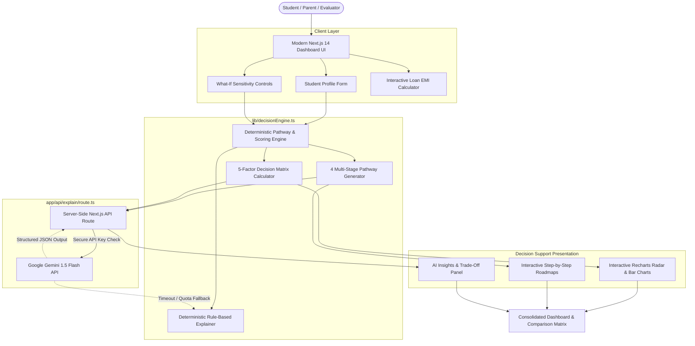

# ARCHITECTURE.md — PathPilot AI System Design

This document details the architectural principles, data flow, scoring mathematics, and AI integration powering **PathPilot AI** for **HACK MATRIX 5.0 (Kali Yuga)** at PCCOE Pune.

---

## 1. High-Level Architecture Overview

PathPilot AI is built on a **Dual-Engine Architecture** that strictly decouples **deterministic mathematical calculations** from **probabilistic generative AI reasoning**. This guarantees zero hallucinations in numerical scoring and 100% operational uptime even when third-party APIs are throttled or disconnected.



---

## 2. End-to-End Information Flow

```
1. Student Profile Input
   (Percentage, Strong Subjects, Aptitudes, Budget, Preferred Location, Target Career)
        ↓
2. Local Decision Engine
   (Calculates base feasibility, cost-to-budget ratios, academic alignments)
        ↓
3. Pathway Generator
   (Synthesizes 4 diverse progression routes: Direct Degree, Hardware/Robotics, Polytechnic Lateral, Applied Data)
        ↓
4. 5-Factor Decision Matrix
   (Academic Fit, Interest Fit, Budget Fit, Admission Odds, Career Alignment)
        ↓
5. What-If Scenario Simulator
   (Calculates sensitivity delta against budget cuts, score fluctuations, or career shifts)
        ↓
6. Hybrid AI Explanation Layer
   (Server-side Gemini 1.5 Flash generates structured strategic trade-offs; seamlessly falls back to local rules if offline)
        ↓
7. Interactive Dashboard UI
   (Recharts visualizations, collapsible timeline roadmaps, college comparisons, loan calculators)
```

---

## 3. Core Engine Mechanics

### 3.1 Transparent Deterministic Scoring

Unlike black-box models, every score in PathPilot AI is mathematically explainable and auditable:

1. **Academic Fit Score ($S_{\text{acad}} \in [0, 100]$):**
   $$S_{\text{acad}} = \min\left(100, \text{Percentage} \times W_{\text{stream}} + \text{Bonus}_{\text{subject}}\right)$$
   Where $W_{\text{stream}}$ measures curriculum rigor (e.g. 0.95 for PCM Engineering) and $\text{Bonus}_{\text{subject}}$ rewards matching declared strengths (e.g. Mathematics and Science).

2. **Budget Fit Score ($S_{\text{budget}} \in [0, 100]$):**
   $$S_{\text{budget}} = \min\left(100, \frac{\text{Annual Budget} \times \text{Duration}}{\text{Estimated Total Cost}} \times 90\right)$$
   Reflects financial buffer. If family budget falls below tuition requirements, the score drops proportionally, signaling the necessity for government fee waivers (MahaDBT) or education loans.

3. **Admission Feasibility ($S_{\text{admiss}} \in [0, 100]$):**
   Derived from entrance percentile benchmarks. Highly competitive autonomous colleges (COEP / PCCOE) carry higher entry variance, whereas Polytechnic Diploma routes provide near-guaranteed direct entry based on Class 10 board merit.

4. **Composite Decision Index:**
   $$\text{Composite Index} = 0.25 S_{\text{acad}} + 0.25 S_{\text{interest}} + 0.20 S_{\text{budget}} + 0.15 S_{\text{admiss}} + 0.15 S_{\text{career}}$$

---

## 4. Server-Side AI Integration & Security Architecture

### 4.1 Strict Server-Side Isolation
- The Google Gemini API key is **never** sent to the client browser.
- All requests flow through `app/api/explain/route.ts`.
- The key is read strictly via `process.env.GEMINI_API_KEY`.
- `.env.local` is included in `.gitignore` to prevent leaks.

### 4.2 Deterministic Local Fallback Protocol
To ensure 100% resilience during live hackathon judging:
- A 7-second abort controller prevents network lag from freezing the UI.
- If the Gemini API key is missing, rate-limited, or returns a non-200 code, the system automatically falls back to `generateDeterministicAIExplanation()` without breaking or showing error dialogs.
- The UI transparently displays whether the explanation was synthesized by **Gemini 1.5 Flash** or the **Deterministic Local AI Engine**.

---

## 5. Technology Stack Summary

- **Frontend & App Framework:** Next.js 14 (App Router, Server & Client Components)
- **Language:** TypeScript 5.6 (Strict Type Safety)
- **Styling:** Tailwind CSS (Custom Dark EdTech Theme, Glassmorphism, Micro-Gradients)
- **Visualizations:** Recharts (RadarChart, BarChart, ResponsiveContainer)
- **Iconography:** Lucide React
- **AI Model:** Google Gemini 1.5 Flash (via Generative Language API)
